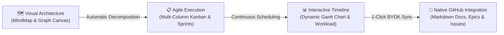
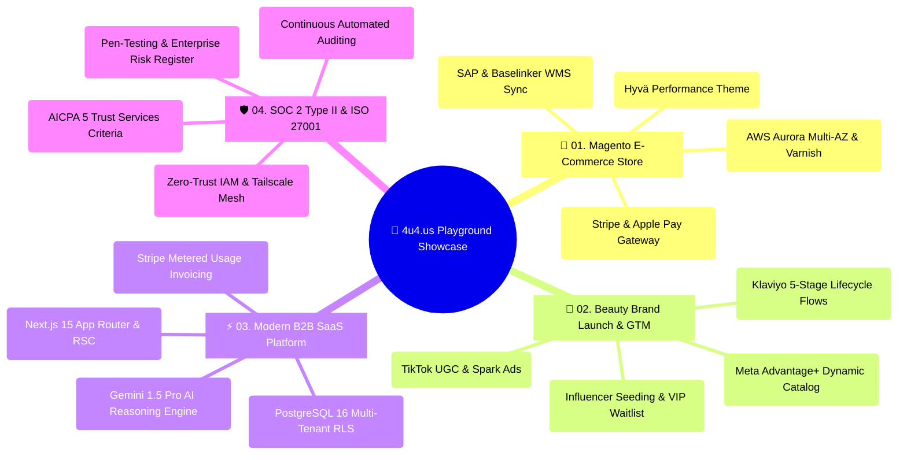
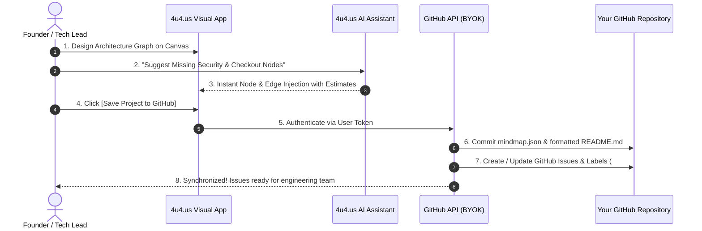

  

# 
 4u4.us — Visual Agile & Architecture Planning

  <strong>From Architecture MindMaps to Sprint-Ready GitHub Code & Documentation in 1 Click</strong>

  
  
  
  

---

## 🌟 What is 4u4.us?

**[4u4.us](https://4u4.us)** is a modern **Visual Agile Ecosystem** built specifically for founders, engineering leads, software architects, and fast-moving agile product teams. It bridges the gap between high-level architectural brainstorming and strict agile execution.

Instead of maintaining disjointed tickets in Jira, outdated diagrams in Miro, and disconnected roadmaps in spreadsheets, **4u4.us synchronizes everything into one live unified graph**:

---

## 🗺️ Unified Architecture Taxonomy

The diagram below illustrates the structural scope of all 4 showcase projects generated directly from their `mindmap.json` data models:

---

## 📂 Production Reference Templates in This Repository

This showcase repository contains **4 real-world, enterprise-grade project templates** generated automatically by **4u4.us**. Each project includes a complete architectural specification, Mermaid system diagrams, tech stack blueprints, sprint roadmaps, and full task registries.

| # | Project Architecture Template | Domain / Industry | Scope & Scale | Interactive Live View | GitHub Documentation & Raw Data |
|---|-------------------------------|-------------------|---------------|-----------------------|---------------------------------|
| 1 | **[Magento E-Commerce Store Design](templates/01-magento-ecommerce-store/README.md)** | Enterprise Retail & E-Commerce | 11 Epics • 33 Tasks • AWS Cloud Infra | [🚀 Open in Playground](https://4u4.us/playground?template=template-magento-store) | [📄 Documentation](templates/01-magento-ecommerce-store/README.md) • [📦 JSON](templates/01-magento-ecommerce-store/mindmap.json) |
| 2 | **[Cosmetics Store Launch & Marketing](templates/02-magento-beauty-marketing/README.md)** | Growth, Funnel & Influencers | 3 Sprints • 20 Tasks • Full Go-To-Market | [🚀 Open in Playground](https://4u4.us/playground?template=template-magento-marketing) | [📄 Documentation](templates/02-magento-beauty-marketing/README.md) • [📦 JSON](templates/02-magento-beauty-marketing/mindmap.json) |
| 3 | **[SaaS Platform & Active Sprint](templates/03-saas-platform-active-sprint/README.md)** | B2B SaaS • AI Engine • Microservices | 9 Epics • 28 Tasks • Multi-Tenant RLS | [🚀 Open in Playground](https://4u4.us/playground?template=template-saas-sprint) | [📄 Documentation](templates/03-saas-platform-active-sprint/README.md) • [📦 JSON](templates/03-saas-platform-active-sprint/mindmap.json) |
| 4 | **[SOC 2 Type II & ISO 27001 Roadmap](templates/04-soc2-type2-iso27001-roadmap/README.md)** | Security, Compliance & DevSecOps | 3 Sprints • 22 Tasks • AICPA Trust Criteria | [🚀 Open in Playground](https://4u4.us/playground?template=template-soc2-compliance) | [📄 Documentation](templates/04-soc2-type2-iso27001-roadmap/README.md) • [📦 JSON](templates/04-soc2-type2-iso27001-roadmap/mindmap.json) |

---

## 🏗️ How the 4u4.us Engine Works

### 1. 🗺️ Infinite-Canvas Architecture MindMapping
* Model systems with parent-child relationships, dependencies, and unlimited branching depth.
* Each node represents an **Architecture Module** or **Agile Epic** with its own time budget, status, owner, and due dates.
* Sub-cards act as discrete **Agile User Stories or Engineering Tasks** ready for execution.

### 2. 📋 Synchronized Kanban Board
* Seamlessly switches to a kanban perspective without losing architectural hierarchy.
* Custom status pipelines (*On Hold, To Do, In Progress, Review, Done*).
* Filter by **Active Sprints**, team members, or epic focus areas.

### 3. 📊 High-Performance Timeline & Gantt
* Auto-calculates start dates, completion windows, and critical paths based on task estimates.
* Calendar navigation with smooth pan/zoom, sprint boundaries, and responsive drag handles.

### 4. 🔄 Bidirectional GitHub Synchronization (BYOK)
* **Bring Your Own Key (BYOK)**: Connect your personal or organizational GitHub Personal Access Token (PAT).
* **Automatic Issue Creation**: Every card in 4u4.us becomes a structured GitHub Issue labeled with epics, sprints, and story points.
* **Continuous Documentation**: Generates production-ready Markdown documentation with Mermaid architecture diagrams directly into your repository.

---

## 🚀 Getting Started

### Option A: Explore in the Interactive Playground
Test the platform directly in your browser without creating an account:
👉 **[Open 4u4.us Playground](https://4u4.us/playground)**

### Option B: Clone and Import to Your Own Workspace
1. Clone this repository or copy the `mindmap.json` file from any template folder.
2. Open **[4u4.us](https://4u4.us)**, sign in, and click **Load Project / Import JSON**.
3. Select your own GitHub repository under **Settings → GitHub Integration**.
4. Click **Save to GitHub** — your issues and documentation will be initialized automatically!

---

  Built with ❤️ by the <strong>4u4.us</strong> team — Unstoppable Productivity for Modern Engineering Armies.

