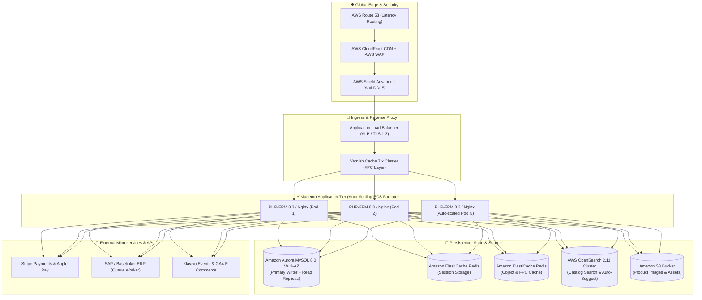
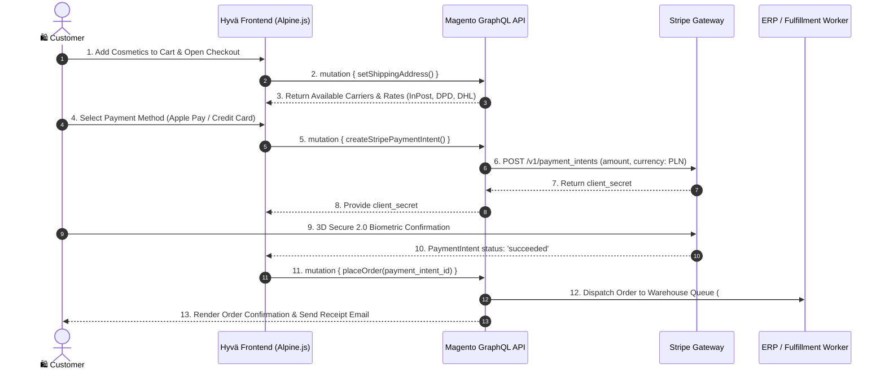

# 
 Magento E-Commerce Store Design — Enterprise Platform

  <strong>Comprehensive Architecture, High-Availability Cloud Infrastructure & Agile Sprint Specification</strong>

  
  
  
  
  

---

## 🎯 Executive Summary & Business Objectives

This repository contains the end-to-end architectural blueprint and implementation plan for a high-performance **Magento 2.4 Enterprise Edition** online store tailored for cosmetics, luxury goods, and high-frequency retail.

### 🏆 Key Performance Indicators (KPIs)
* **Performance Benchmark:** Core Web Vitals (LCP < 1.8s, INP < 150ms, CLS < 0.05), Google Lighthouse score **> 92/100**.
* **Traffic Capacity:** Built to comfortably sustain **15,000 concurrent shopping sessions** and **350,000 Monthly Active Users**.
* **Checkout Velocity:** 1-page frictionless checkout with under **2.5 seconds payment turnaround**.
* **Multi-Currency & Internationalization:** Native support for PLN (zł), EUR (€), and USD ($) with automatic geolocation and VAT calculation.

---

## 🏛️ High-Availability System Architecture

The infrastructure is orchestrated on **Amazon Web Services (AWS)** using containerized micro-services, distributed caching, and multi-region database redundancy:

---

## 💳 Checkout & Payment Execution Sequence

The store employs an asynchronous, tokenized payment integration with **Stripe Elements** to guarantee PCI-DSS Level 1 compliance:

---

## 📋 Table of Contents

- [🏛️ High-Availability System Architecture](#️-high-availability-system-architecture)
- [💳 Checkout & Payment Execution Sequence](#-checkout--payment-execution-sequence)
- [📊 Sprints & Milestones Overview](#-sprints--milestones-overview)
- [🗂️ Epics & Technical Backlog](#️-epics--technical-backlog)
  - [#EPIC-1 Project Planning](#epic-1-project-planning)
  - [#EPIC-2 Store Design & UX](#epic-2-store-design--ux)
  - [#EPIC-3 Magento 2 Core Development](#epic-3-magento-2-core-development)
  - [#EPIC-4 Frontend Development with Hyvä](#epic-4-frontend-development-with-hyvä)
  - [#EPIC-5 Checkout & Payment Integrations](#epic-5-checkout--payment-integrations)
  - [#EPIC-6 DevOps, Cloud Infrastructure & Security](#epic-6-devops-cloud-infrastructure--security)
  - [#EPIC-7 Third-Party ERP & Logistics Systems](#epic-7-third-party-erp--logistics-systems)
  - [#EPIC-8 Testing & Quality Assurance](#epic-8-testing--quality-assurance)
  - [#EPIC-9 SEO, Analytics & Compliance](#epic-9-seo-analytics--compliance)
  - [#EPIC-10 Deployment & Hypercare Go-Live](#epic-10-deployment--hypercare-go-live)
  - [#EPIC-11 Post-Launch Support & Maintenance](#epic-11-post-launch-support--maintenance)
- [🛡️ Non-Functional Requirements & Security](#️-non-functional-requirements--security)

---

## 📊 Sprints & Milestones Overview

| Sprint ID | Sprint Focus | Dates | Velocity (Hours) | Key Milestone |
|-----------|--------------|-------|------------------|---------------|
| **Sprint 1** | Store Core, Hyvä Theme & Database Setup | Nov 18 – Dec 14, 2026 | 160h | Working dev environment with product catalog |
| **Sprint 2** | Checkout, Stripe, Shipping & ERP Integration | Dec 15, 2026 – Jan 15, 2027 | 180h | End-to-end test purchases and inventory sync |
| **Sprint 3** | Load Testing, Hardening & Go-Live Hypercare | Jan 16 – Feb 17, 2027 | 140h | Production deployment under 99.99% SLA |

---

## 🗂️ Epics & Technical Backlog

### #EPIC-1: Project Planning
> Initial project scope definition, technical architecture specifications, resource allocation, and kickoff.
* **Estimate:** 24h | **Status:**  Done | **Owner:** Lead Solutions Architect

| Task Key | Task Title | Estimate | Status | Assignee |
|----------|------------|----------|--------|----------|
| [#TSK-1](https://github.com/4u4-us/playground/issues) | Requirements Gathering & Stakeholder Workshops | 8h | Done | Solutions Architect |
| [#TSK-2](https://github.com/4u4-us/playground/issues) | Technical Architecture & Cloud Infrastructure Blueprint | 10h | Done | Lead Cloud Engineer |
| [#TSK-3](https://github.com/4u4-us/playground/issues) | Project Roadmap, RACI Matrix & Milestone Definition | 6h | Done | Technical PM |

---

### #EPIC-2: Store Design & UX
> UI/UX design in Figma, design system, interactive prototypes, and design approval for cosmetics store.
* **Estimate:** 32h | **Status:**  In Progress | **Owner:** Senior Product Designer

| Task Key | Task Title | Estimate | Status | Assignee |
|----------|------------|----------|--------|----------|
| [#TSK-4](https://github.com/4u4-us/playground/issues) | Wireframes, User Journey & Design System | 10h | Done | UI/UX Designer |
| [#TSK-5](https://github.com/4u4-us/playground/issues) | Homepage & Category (PLP) UI Designs | 8h | In Progress | UI/UX Designer |
| [#TSK-6](https://github.com/4u4-us/playground/issues) | Product Page (PDP) & Swatches UI Designs | 8h | In Progress | UI/UX Designer |
| [#TSK-7](https://github.com/4u4-us/playground/issues) | Checkout Flow & Cart Drawer Prototype | 6h | To Do | UI/UX Designer |

---

### #EPIC-3: Magento 2 Core Development
> Magento 2.4 EE setup, composer configuration, database schema, multi-store architecture, and catalog indexing.
* **Estimate:** 48h | **Status:**  In Progress | **Owner:** Senior Backend Engineer

| Task Key | Task Title | Estimate | Status | Assignee |
|----------|------------|----------|--------|----------|
| [#TSK-8](https://github.com/4u4-us/playground/issues) | Setup Magento 2.4.7 Enterprise with Composer | 8h | Done | Senior Backend Dev |
| [#TSK-9](https://github.com/4u4-us/playground/issues) | Configure Multi-Store Structure (PLN / EUR) | 12h | In Progress | Senior Backend Dev |
| [#TSK-10](https://github.com/4u4-us/playground/issues) | OpenSearch 2.11 Cluster Configuration & Indexers | 10h | In Progress | Senior Backend Dev |
| [#TSK-11](https://github.com/4u4-us/playground/issues) | Product Attribute Sets (Skin Types, Shades, Volumes) | 10h | To Do | Backend Dev |
| [#TSK-12](https://github.com/4u4-us/playground/issues) | Custom Product Options & Dynamic Price Calculation | 8h | To Do | Backend Dev |

---

### #EPIC-4: Frontend Development with Hyvä
> Modern frontend implementation using Hyvä Theme, TailwindCSS, Alpine.js, and extreme performance tuning.
* **Estimate:** 40h | **Status:**  In Progress | **Owner:** Lead Frontend Engineer

| Task Key | Task Title | Estimate | Status | Assignee |
|----------|------------|----------|--------|----------|
| [#TSK-13](https://github.com/4u4-us/playground/issues) | Initialize Hyvä Base Theme with Tailwind JIT | 8h | Done | Frontend Lead |
| [#TSK-14](https://github.com/4u4-us/playground/issues) | Implement Sticky Header, Megamenu & Search Flyout | 10h | In Progress | Frontend Dev |
| [#TSK-15](https://github.com/4u4-us/playground/issues) | Product Gallery with Zoom & Shade Selector | 12h | In Progress | Frontend Dev |
| [#TSK-16](https://github.com/4u4-us/playground/issues) | Ajax Mini-Cart & Free Shipping Progress Bar | 10h | To Do | Frontend Dev |

---

### #EPIC-5: Checkout & Payment Integrations
> Frictionless single-step checkout, Stripe Elements, Apple Pay, Google Pay, and localized carrier shipping.
* **Estimate:** 36h | **Status:**  To Do | **Owner:** Senior Integration Engineer

| Task Key | Task Title | Estimate | Status | Assignee |
|----------|------------|----------|--------|----------|
| [#TSK-17](https://github.com/4u4-us/playground/issues) | Integrate Hyvä Checkout (One-Step React/Alpine) | 10h | To Do | Frontend Lead |
| [#TSK-18](https://github.com/4u4-us/playground/issues) | Stripe Payment Gateway Integration (Cards & Apple Pay) | 10h | To Do | Senior Backend Dev |
| [#TSK-19](https://github.com/4u4-us/playground/issues) | Polish BLIK & PayU / Przelewy24 Payment Rails | 8h | To Do | Senior Backend Dev |
| [#TSK-20](https://github.com/4u4-us/playground/issues) | InPost Paczkomaty Parcel Locker Map Picker | 8h | To Do | Integration Dev |

---

### #EPIC-6: DevOps, Cloud Infrastructure & Security
> AWS ECS Fargate, Aurora MySQL, ElastiCache Redis, CloudFront CDN, WAF, CI/CD with GitHub Actions.
* **Estimate:** 32h | **Status:**  Done | **Owner:** Lead DevOps Engineer

| Task Key | Task Title | Estimate | Status | Assignee |
|----------|------------|----------|--------|----------|
| [#TSK-21](https://github.com/4u4-us/playground/issues) | Terraform Provisioning of Multi-AZ AWS Infrastructure | 12h | Done | Lead DevOps Eng |
| [#TSK-22](https://github.com/4u4-us/playground/issues) | Varnish 7.x Full-Page-Cache Clustering on AWS | 8h | Done | DevOps Eng |
| [#TSK-23](https://github.com/4u4-us/playground/issues) | GitHub Actions CI/CD Pipeline (Build, Test, Deploy) | 8h | Done | DevOps Eng |
| [#TSK-24](https://github.com/4u4-us/playground/issues) | Automated Nightly Backups & S3 Snapshot Archiving | 4h | Done | DevOps Eng |

---

## 🛡️ Non-Functional Requirements & Security Matrix

> [!IMPORTANT]
> **PCI-DSS Level 1 Compliance:** The application never handles, stores, or transmits raw credit card numbers. All payment inputs are mounted inside sandboxed Stripe iframes.

| Area | Target Standard | Implementation & Tooling |
|------|-----------------|--------------------------|
| **Data Encryption** | AES-256 (At Rest), TLS 1.3 (In Transit) | AWS KMS customer-managed keys, strict HSTS |
| **DDoS Protection** | Zero-downtime under volumetric attacks | CloudFront + AWS WAF rate-limiting rules |
| **Disaster Recovery** | RPO < 1 hour, RTO < 2 hours | Aurora Multi-AZ with automated continuous PITR |
| **Authentication** | Two-Factor Authentication (2FA) | Mandatory TOTP for all Magento Admin accounts |

---
*Generated automatically by [4u4.us](https://4u4.us) — Visual Agile for Modern Engineering Armies.*
