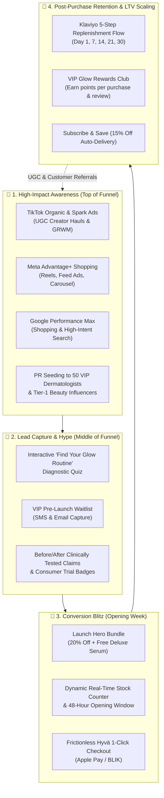
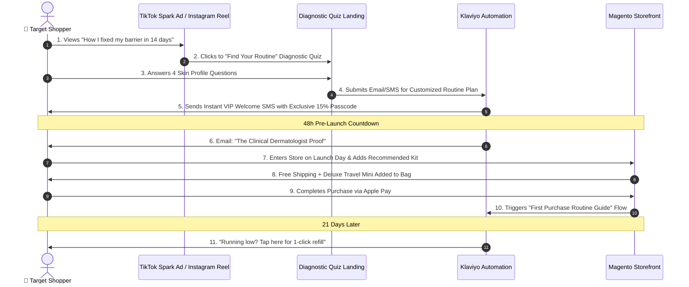
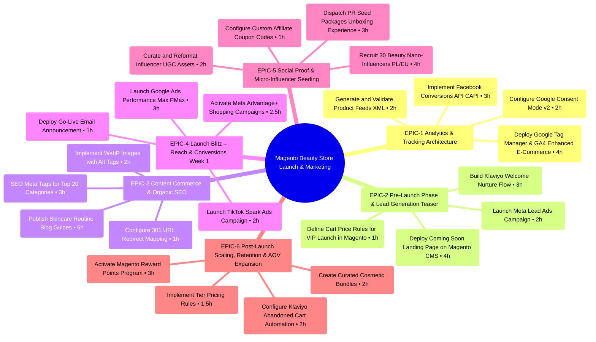
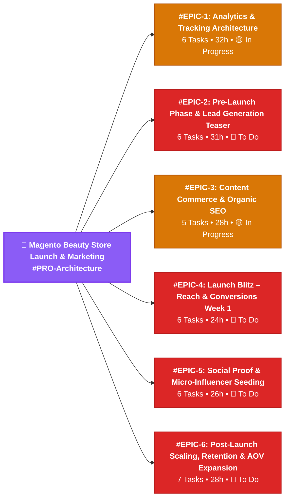
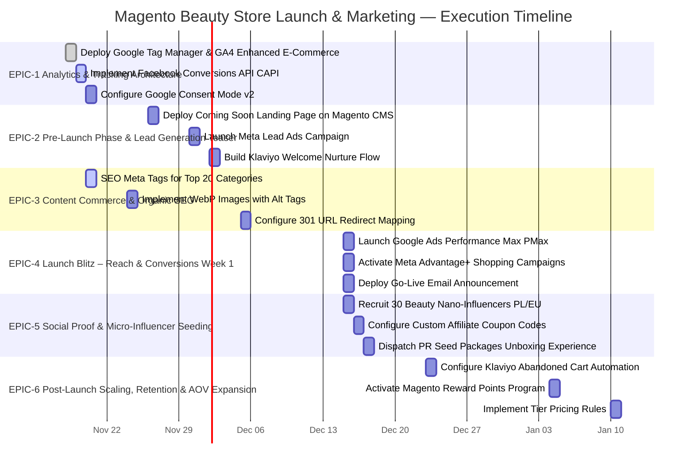

  

# 
 Magento Beauty Store Launch & Marketing Strategy

  <strong>High-Velocity Go-To-Market Plan, Multi-Channel Performance Ads & Influencer Engine</strong>

  
  
  
  
  

---

## 🚀 Growth Blueprint & Campaign Strategy

This project contains the **comprehensive 90-day Go-To-Market (GTM) execution playbook** designed to launch an e-commerce beauty and cosmetics brand, driving immediate brand recognition, high pre-order volume, and sustainable repeat customer retention.

---

## 📈 Marketing Funnel & Customer Journey Lifecycle

---

## 💰 Launch Budget Allocation & KPI Targets

| Channel / Initiative | Budget Allocation | Share (%) | Primary Goal | Target Metric |
|----------------------|-------------------|-----------|--------------|---------------|
| **Meta Advantage+ Ads** | $32,000 | 37.6% | New Customer Acquisition | ROAS > 3.6x • CPA < $24 |
| **TikTok Spark & Creator Ads** | $22,000 | 25.9% | Viral UGC & Gen-Z Discovery | Video View Rate > 18% • CPC < $0.45 |
| **Google Performance Max** | $14,000 | 16.5% | High-Intent Bottom Funnel | ROAS > 4.5x • Conversion Rate > 3.8% |
| **Influencer Seeding Kits** | $8,500 | 10.0% | Organic Endorsements & PR | 60+ Authentic Stories & Unboxings |
| **Klaviyo Email & SMS Tools** | $4,500 | 5.3% | Lead Nurture & Retention | Attributed Revenue > 28% |
| **Creative Production & UGC** | $4,000 | 4.7% | High-Converting Ad Hooks | 25 High-Performing Creative Assets |
| **Total Campaign** | **$85,000 USD** | **100%** | **Blended Campaign** | **Target Blended MER > 4.2x** |

---

---

## 🗺️ Interactive MindMap Graph (Generated 1:1 from `mindmap.json`)

> **Dynamic Architecture Decomposition:** The native Mermaid diagram below is generated programmatically from the `mindmap.json` data tree. Each branch represents an architecture epic, and terminal leaves represent actionable agile user stories and tasks.

---

## 🌳 Epic Hierarchy & Status Flow (from `mindmap.json`)

> **Real-Time Agile Pipeline:** Nodes are color-coded based on live completion status (■ Done, ■ In Progress, ■ To Do).

---

## ⏱️ Dynamic Agile Gantt Timeline (from `mindmap.json`)

> **Continuous Scheduling Engine:** Auto-projected task start dates, durations (derived from estimated hours), and critical execution paths.

## 🗂️ Sprints & Detailed Campaign Backlog

### Sprint 1: Tracking Setup & Pre-Launch Lead Generation (Nov 18 – Dec 14, 2026)
* **Goal:** Generate 10,000 VIP email/SMS pre-launch subscribers and validate tracking infrastructure.

| Task Key | Task Description | Channel | Target / Deliverable | Status |
|----------|------------------|---------|----------------------|--------|
|  | Deploy Coming Soon Landing Page on Subdomain | Web | High-converting waitlist page | Done |
| &nbsp;&nbsp;&nbsp;&nbsp;**** | **Support Ticket: VIP Waitlist SMS early-access URL redirection loop** | SMS | Verified SSL handshake fix | Closed |
|  | Launch Meta Lead Ads Campaign (VIP Early Access) | Meta | Target CPL < $1.40 | In Progress |
|  | Build Klaviyo Welcome Nurture Sequence (5 Emails) | Email | 48% Open Rate benchmark | In Progress |
| &nbsp;&nbsp;&nbsp;&nbsp;**** | **Marketing Defect: Meta Conversions API purchase event deduplication mismatch** | CAPI | 100% match quality fix | Open |
|  | Commission Teaser UGC Video Production (8 Creators) | TikTok | 8 Approved Video Concepts | Done |
|  | Implement Server-Side GTM, Meta CAPI & GA4 Events | Tracking | 100% Event Match Quality | Done |

---

### Sprint 2: Launch Blitz & Influencer Amplification (Dec 15, 2026 – Jan 15, 2027)
* **Goal:** Drive $220,000 in first 30 days revenue with aggressive paid ads and influencer unboxings.

| Task Key | Task Description | Channel | Target / Deliverable | Status |
|----------|------------------|---------|----------------------|--------|
|  | Deploy Go-Live Email & SMS Announcement Blast | CRM | 10k VIP audience blast | To Do |
|  | Launch Google Performance Max & Brand Search Campaigns | Google | Top-position brand defense | To Do |
|  | Activate Meta Advantage+ Catalog Dynamic Product Ads | Meta | Dynamic retargeting ads | To Do |
|  | Launch TikTok Spark Ads using Creator Whitelisted Handles | TikTok | Scale top 3 viral UGC hooks | To Do |
|  | Real-Time Funnel Monitoring & Abandoned Cart Recovery | CRO | Cart abandonment rate < 62% | To Do |

---

### Sprint 3: Retention, LTV Expansion & Affiliate Scaling (Jan 16 – Feb 17, 2027)
* **Goal:** Maximize repeat customer rate (>22%) and initiate recurring auto-replenishment subscriptions.

| Task Key | Task Description | Channel | Target / Deliverable | Status |
|----------|------------------|---------|----------------------|--------|
|  | Launch Post-Purchase Educational Sequence | Klaviyo | Reduce returns to < 2.5% | To Do |
|  | Deploy VIP Glow Club Loyalty & Referral Program | Loyalty | 15% referral participation | To Do |
|  | Launch Subscribe & Save Replenishment Option | Product | 12% subscription opt-in | To Do |
|  | Onboard 40 Micro-Affiliates with Custom Tracking Links | Affiliate | Tracked via UpPromote | To Do |

---
*Generated automatically by [4u4.us](https://4u4.us) — Visual Agile for Modern Engineering Armies.*
