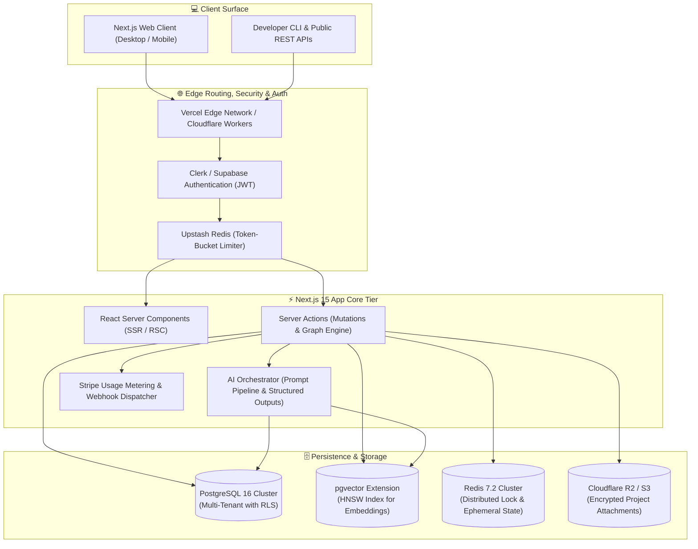
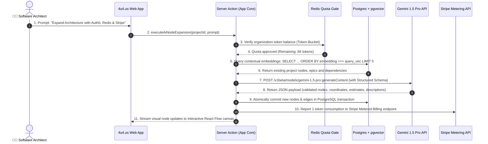
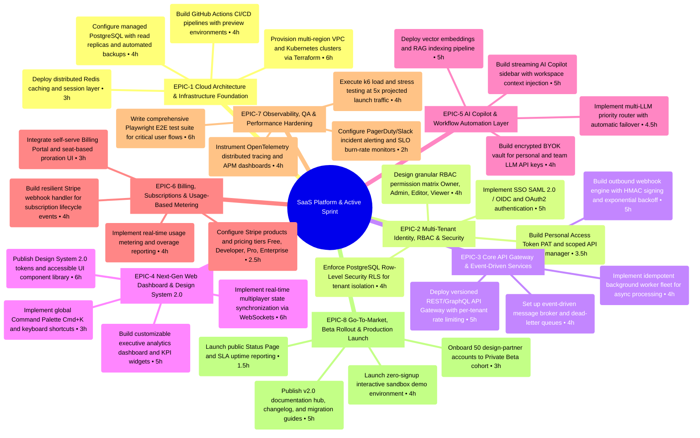
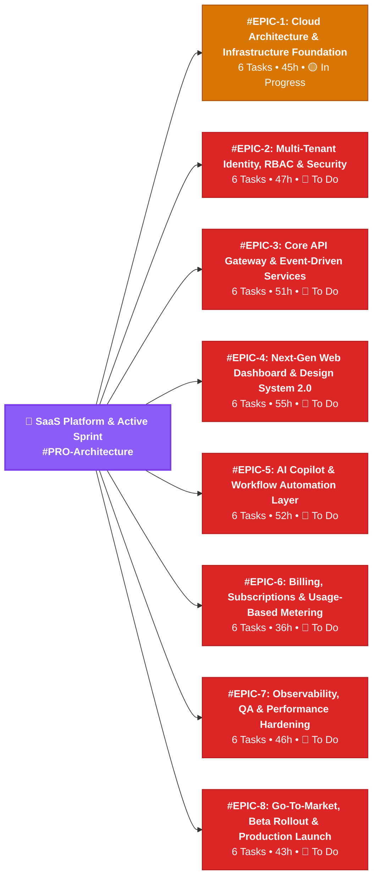
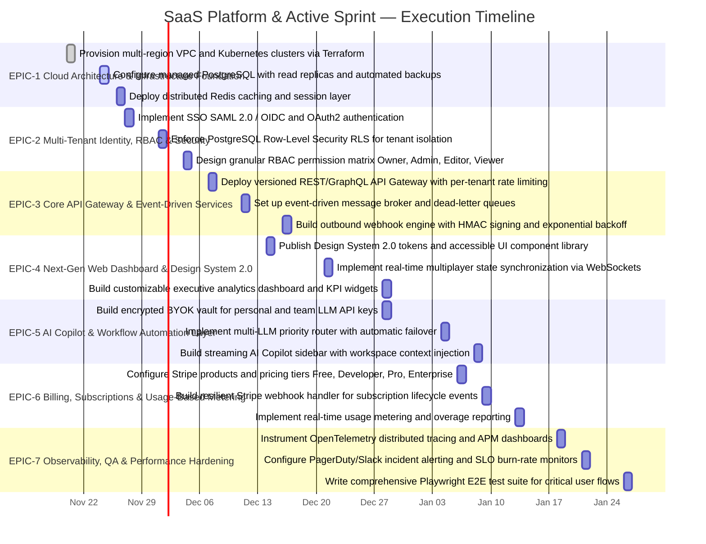

# <p align="center"> Modern B2B SaaS Platform — Production Architecture</p>

<p align="center">
  <strong>Multi-Tenant Microservices, AI Reasoning Engine, Next.js 15 App Router & Stripe Metered Billing</strong>
</p>

<p align="center">
  
  
  
  
  
  
</p>

---

## ⚡ Architectural Principles & System Design

This project represents the core architecture of a high-growth **B2B SaaS application**. Built for horizontal scalability, sub-second latency, and strict enterprise multi-tenancy:

* **Zero-Leakage Multi-Tenancy:** Hardened Row-Level Security (RLS) on PostgreSQL enforced at the database kernel level.
* **Hybrid Rendering:** React Server Components (RSC) for maximum SEO and sub-100ms first-contentful paint, combined with client-side interactive canvas components.
* **Vector Semantic Search:** High-performance similarity searches via `pgvector` enabling AI contextual memory and rag pipelines.
* **Metered Credit System:** Token-bucket rate limiting backed by Upstash Redis with real-time usage synchronization to Stripe Billing v3.

---

## 🏛️ End-to-End Cloud Topology



---

## 🤖 Contextual AI Inference & Usage Metering Flow



---


---

## 🗺️ Interactive MindMap Graph (Generated 1:1 from `mindmap.json`)

> **Dynamic Architecture Decomposition:** The native Mermaid diagram below is generated programmatically from the `mindmap.json` data tree. Each branch represents an architecture epic, and terminal leaves represent actionable agile user stories and tasks.



---

## 🌳 Epic Hierarchy & Status Flow (from `mindmap.json`)

> **Real-Time Agile Pipeline:** Nodes are color-coded based on live completion status (<span style="color:#059669">■</span> Done, <span style="color:#d97706">■</span> In Progress, <span style="color:#dc2626">■</span> To Do).



---

## ⏱️ Dynamic Agile Gantt Timeline (from `mindmap.json`)

> **Continuous Scheduling Engine:** Auto-projected task start dates, durations (derived from estimated hours), and critical execution paths.



## 🗂️ Active Sprints & Engineering Roadmap

### Sprint 1: Cloud Foundation, Database Schema & Authentication (Nov 20 – Dec 14, 2026)
* **Goal:** Deliver production-ready multi-tenant infrastructure, tenant isolation, and user authentication.

| Task Key | Technical Deliverable | Stack | Estimate | Status |
|----------|-----------------------|-------|----------|--------|
| [#TSK-S1](https://github.com/4u4-us/playground/issues) | Setup Next.js 15 Monorepo with Turborepo & Tailwind | Next.js / TS | 10h | Done |
| [#TSK-S2](https://github.com/4u4-us/playground/issues) | Configure PostgreSQL with RLS & Drizzle ORM Schema | Postgres / Drizzle | 14h | Done |
| [#TSK-S3](https://github.com/4u4-us/playground/issues) | Multi-Tenant Organization Switcher & JWT Middleware | Clerk / Next.js | 12h | Done |
| [#TSK-S4](https://github.com/4u4-us/playground/issues) | Upstash Redis Distributed Rate Limiting Configuration | Upstash / Redis | 8h | In Progress |
| [#TSK-S5](https://github.com/4u4-us/playground/issues) | GitHub Actions CI/CD Pipeline with Automated E2E | Playwright | 10h | In Progress |

---

### Sprint 2: Core APIs, Design System & AI Reasoning Engine (Dec 15, 2026 – Jan 18, 2027)
* **Goal:** Deploy the interactive architecture canvas, vector embeddings search, and Gemini reasoning engine.

| Task Key | Technical Deliverable | Stack | Estimate | Status |
|----------|-----------------------|-------|----------|--------|
| [#TSK-S6](https://github.com/4u4-us/playground/issues) | Interactive React Flow Canvas with Custom Node Renderers | React Flow / Canvas | 16h | In Progress |
| [#TSK-S7](https://github.com/4u4-us/playground/issues) | Integrate Gemini 1.5 Pro with Zod Schema Validation | Google GenAI SDK | 14h | In Progress |
| [#TSK-S8](https://github.com/4u4-us/playground/issues) | Setup pgvector HNSW Index for Architecture Semantic Search | pgvector | 10h | To Do |
| [#TSK-S9](https://github.com/4u4-us/playground/issues) | Real-Time Collaborative WebSockets with Yjs | Yjs / WebSockets | 18h | To Do |
| [#TSK-S10](https://github.com/4u4-us/playground/issues) | REST API v1 Endpoints (/api/v1/projects, /api/v1/nodes) | Next.js Route Handlers | 12h | To Do |

---

### Sprint 3: Monetization, Hardening & Enterprise Launch (Jan 19 – Feb 19, 2027)
* **Goal:** Deploy Stripe customer portal, usage-based invoicing, team RBAC, and SOC 2 security compliance.

| Task Key | Technical Deliverable | Stack | Estimate | Status |
|----------|-----------------------|-------|----------|--------|
| [#TSK-S11](https://github.com/4u4-us/playground/issues) | Stripe Billing v3 Subscriptions & Webhook Processing | Stripe SDK | 14h | To Do |
| [#TSK-S12](https://github.com/4u4-us/playground/issues) | Usage-Based Invoicing & Real-Time Token Tracking UI | React / Server Actions | 10h | To Do |
| [#TSK-S13](https://github.com/4u4-us/playground/issues) | Team RBAC Permissions (Owner, Admin, Member, Viewer) | Drizzle / Postgres RLS | 12h | To Do |
| [#TSK-S14](https://github.com/4u4-us/playground/issues) | Audit Log Streaming & Security Event Tracking | Datadog / OpenTelemetry | 8h | To Do |

---

## 🔒 Multi-Tenant Database Schema with Row-Level Security (RLS)

```sql
-- Enable Row Level Security (RLS) on primary tables
ALTER TABLE "projects" ENABLE ROW LEVEL SECURITY;
ALTER TABLE "nodes" ENABLE ROW LEVEL SECURITY;

-- Enforce strict organization isolation
CREATE POLICY tenant_project_isolation ON "projects"
  FOR ALL
  USING (organization_id = current_setting('app.current_org_id', true));

CREATE POLICY tenant_node_isolation ON "nodes"
  FOR ALL
  USING (organization_id = current_setting('app.current_org_id', true));
```

---
*Generated automatically by [4u4.us](https://4u4.us) — Visual Agile for Modern Engineering Armies.*
