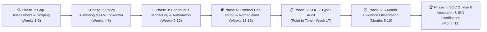
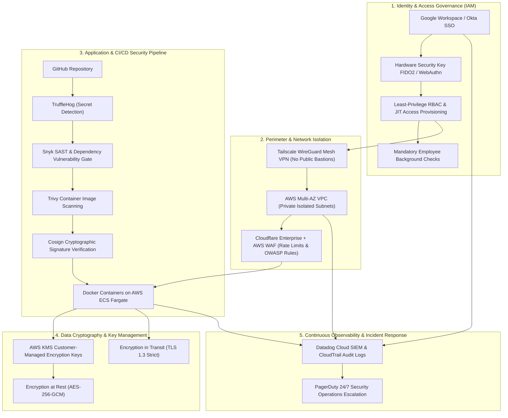
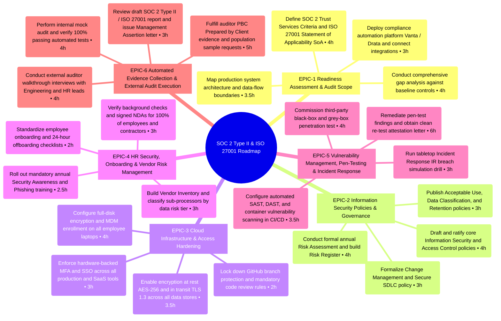
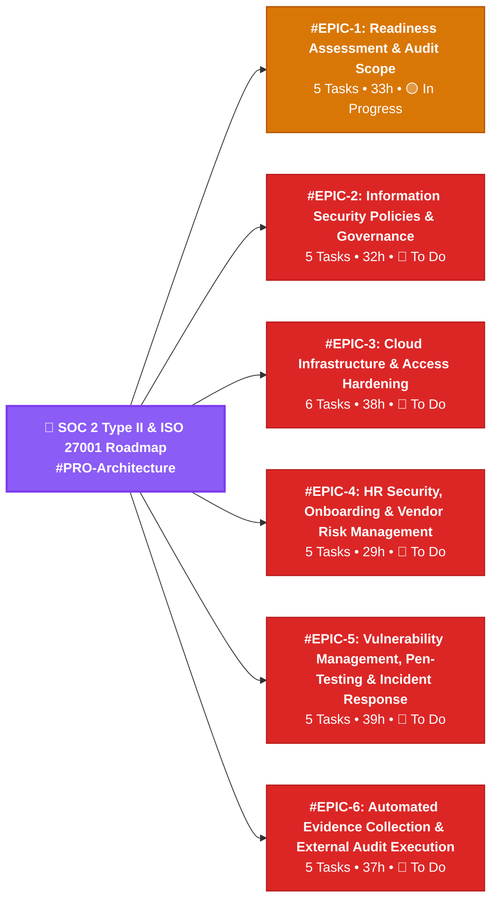
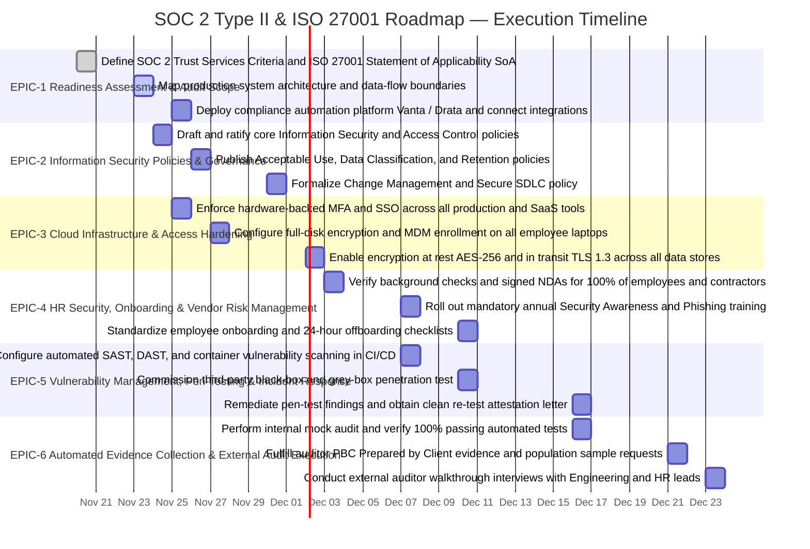

  

# 
 SOC 2 Type II & ISO 27001 Enterprise Roadmap

  <strong>Comprehensive Information Security Management System (ISMS) & Trust Services Criteria Implementation</strong>

  
  
  
  
  

---

## 🛡️ Executive Mandate & Certification Scope

This roadmap outlines the complete enterprise journey to achieve **SOC 2 Type II** attestation and **ISO/IEC 27001:2022** certification for a cloud-native SaaS infrastructure.

The certification encompasses all **5 AICPA Trust Services Criteria (TSC)**:
1. **Security:** Protecting against unauthorized access and system breaches.
2. **Availability:** Ensuring 99.99% operational uptime and robust disaster recovery.
3. **Confidentiality:** Strict encryption and data handling controls for customer proprietary data.
4. **Processing Integrity:** Complete, valid, accurate, and authorized transaction processing.
5. **Privacy:** Full compliance with GDPR, CCPA, and global privacy mandates.

---

## 📅 Compliance Roadmap & Audit Lifecycle

---

## 🏰 Zero-Trust Multi-Layer Security Architecture

---

---

## 🗺️ Interactive MindMap Graph (Generated 1:1 from `mindmap.json`)

> **Dynamic Architecture Decomposition:** The native Mermaid diagram below is generated programmatically from the `mindmap.json` data tree. Each branch represents an architecture epic, and terminal leaves represent actionable agile user stories and tasks.

---

## 🌳 Epic Hierarchy & Status Flow (from `mindmap.json`)

> **Real-Time Agile Pipeline:** Nodes are color-coded based on live completion status (■ Done, ■ In Progress, ■ To Do).

---

## ⏱️ Dynamic Agile Gantt Timeline (from `mindmap.json`)

> **Continuous Scheduling Engine:** Auto-projected task start dates, durations (derived from estimated hours), and critical execution paths.

## 🗂️ Sprints & Detailed Compliance Execution

### Sprint 1: Scope, Policies & Cloud Hardening (Nov 20 – Dec 04, 2026)
* **Goal:** Finalize 18 statutory information security policies and enforce cloud infrastructure security baselines.

| Control Key | Security Domain | Implementation Specification | Status |
|-------------|-----------------|------------------------------|--------|
| **CC6.1** | Logical Access Controls | Enforce Okta SSO with WebAuthn/FIDO2 MFA for all employees | Done |
| **CC6.6** | Data Encryption | Enable AES-256 encryption on all RDS clusters, Redis & S3 buckets | Done |
| **CC6.7** | Transit Protection | Strict TLS 1.3 with automated certificate rotation via ACM | Done |
| **CC2.1** | Governance & Policy | Author and publish Information Security Policy & Acceptable Use | In Progress |
| **CC5.1** | Risk Assessment | Conduct annual Threat Model & Enterprise Risk Assessment | In Progress |
| &nbsp;&nbsp;**** | **Audit Finding: Remediate inactive AWS IAM programmatic access keys older than 90 days** | IAM / SOC 2 | Open |

---

### Sprint 2: Vendor Risk, Pen-Testing & Incident Response (Dec 07 – Dec 18, 2026)
* **Goal:** Execute third-party penetration test and formalize Vendor Risk Management (VRM) reviews.

| Control Key | Security Domain | Implementation Specification | Status |
|-------------|-----------------|------------------------------|--------|
| **CC7.1** | Vulnerability Scanning | Automated daily vulnerability scans on infrastructure with Snyk | In Progress |
| **CC7.2** | Penetration Testing | Independent CREST-accredited white-box penetration test | To Do |
| &nbsp;&nbsp;**** | **Security Incident Drill: Tabletop breach simulation & PagerDuty runbook update** | SecOps / IR | Closed |
| **CC9.2** | Vendor Management | Security review & DPA execution for all critical SaaS vendors | To Do |
| **CC7.3** | Incident Response | Tabletop Incident Response Simulation with PagerDuty runbooks | To Do |
| **CC8.1** | Change Control | Mandatory 2-person code review and automated CI security gates | Done |

---

### Sprint 3: Mock Audit, Evidence Sampling & Trust Center (Dec 21 – Dec 31, 2026)
* **Goal:** Conduct mock audit with external CPA firm and deploy public customer Trust Center.

| Control Key | Security Domain | Implementation Specification | Status |
|-------------|-----------------|------------------------------|--------|
| **CC3.2** | Evidence Collection | Automated evidence collection via Vanta / Drata agent integration | To Do |
| **CC4.1** | Audit Sampling | Review 25 random change requests and employee offboarding records | To Do |
| **CC1.4** | Security Training | 100% completion of annual KnowBe4 security awareness training | To Do |
| **TRUST** | Public Trust Center | Launch public security trust page with self-service NDA access | To Do |
| **FINAL** | Type I Examination | External AICPA certified auditor signs off on Type I report | To Do |

---

## 📊 Enterprise Risk Register

| Risk ID | Threat Scenario | Inherent Risk | Mitigation Controls | Residual Risk |
|---------|-----------------|---------------|---------------------|---------------|
| **RSK-01** | Compromised Employee Credentials | High (9/10) | Hardware FIDO2 MFA, JIT Access, Session timeout after 15m | Low (2/10) |
| **RSK-02** | Supply Chain / Vulnerable Dependency | Critical (10/10) | Snyk SAST blocking PRs, automated Dependabot alerts | Low (2/10) |
| **RSK-03** | Production Data Leak / Unencrypted Backup | Critical (10/10) | AWS KMS customer-managed keys, zero public S3 bucket policies | Very Low (1/10) |
| **RSK-04** | Ransomware / Data Destruction | High (8/10) | AWS S3 Object Lock, immutable cross-region backups, RPO < 15m | Very Low (1/10) |

---
*Generated automatically by [4u4.us](https://4u4.us) — Visual Agile for Modern Engineering Armies.*
